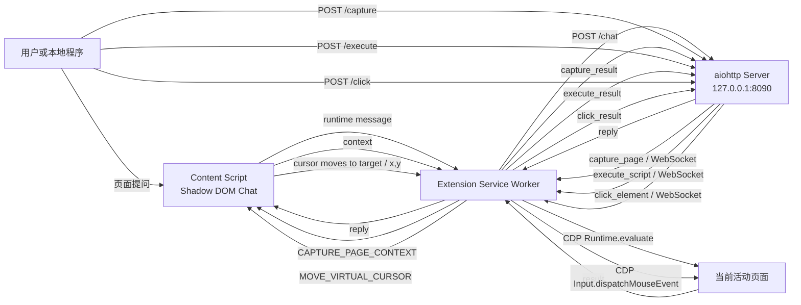

# Page Context Chat

Page Context Chat 是一个 Manifest V3 Chrome Extension 和本地 Python 服务组成的浏览器页面助手。扩展向普通 HTTP/HTTPS 页面注入聊天 UI，按需采集当前页面上下文，并与仅监听 `127.0.0.1:8090` 的服务通信。

项目当前支持三条主要链路：

- 在页面聊天组件中提问，将问题、最近会话和完整页面上下文发送到本地 `/chat`。
- 由本地程序调用 `/capture`，通过 WebSocket 主动触发扩展采集当前活动标签页。
- 显式启用高风险模式后，由本地程序调用 `/execute`，在当前活动标签页的页面主世界执行 JavaScript。

## 功能概览

### 页面聊天组件

- 自动注入到所有普通 HTTP/HTTPS 页面。
- 扩展重新加载或更新后，会自动向已打开的页面重新注入内容脚本，通常无需手动刷新。
- 使用关闭的 Shadow DOM 隔离页面样式和组件样式。
- 支持右下角按钮、响应式聊天面板、发送状态和错误消息。
- `Enter` 发送，`Shift+Enter` 换行。
- 可通过页面按钮或 Chrome 工具栏扩展按钮显示和隐藏。
- 聊天历史仅保存在当前内容脚本内存中，每次请求最多发送最近 10 条历史消息。
- 请求本地 `/chat` 的超时时间为 30 秒。

### 页面上下文采集

扩展在用户发送聊天消息或服务端触发 `/capture` 时读取当前动态 DOM，生成以下上下文：

| 字段 | 类型 | 内容与限制 |
|---|---|---|
| `url` | string | 当前页面完整 URL |
| `title` | string | `document.title` |
| `language` | string | 页面 `lang`，缺失时使用浏览器语言 |
| `description` | string | `description` 或 `og:description`，最多 1,000 字符 |
| `selectedText` | string | 当前选中文本，最多 10,000 字符 |
| `headings` | array | 前 60 个 `h1`、`h2`、`h3`，包含 `level` 和 `text` |
| `interactiveElements` | array | 前 80 个链接、按钮、非密码输入框、下拉框和文本域 |
| `visibleText` | string | `document.body.innerText` 规范化结果，最多 30,000 字符 |
| `html` | string | 当前 `document.documentElement.outerHTML`，存在 DOCTYPE 时包含 DOCTYPE，不截断 |

`interactiveElements` 中的每项结构为：

```json
{
  "tag": "a",
  "type": "",
  "text": "Example link",
  "href": "https://example.com/"
}
```

密码输入框不会进入 `interactiveElements`，但完整 HTML 仍可能包含隐藏内容、表单默认值、令牌或其他敏感数据。

### 服务端主动采集

- 扩展后台连接 `ws://127.0.0.1:8090/ws`。
- 服务端收到 `POST /capture` 后生成 `requestId`，向扩展发送采集命令并等待对应结果。
- 扩展采集当前聚焦 Chrome 窗口的活动标签页。
- WebSocket 每 20 秒保活，断开后按 1、2、4、8、10 秒上限指数退避重连。
- 服务端等待采集结果的超时时间为 15 秒。

### JavaScript 执行

- `/execute` 默认关闭，只有使用 `--allow-js-execution` 启动服务时才开放。
- 仅允许当前活动的 HTTP/HTTPS 标签页。
- 扩展通过 Chrome DevTools Protocol `Runtime.evaluate` 在页面主世界执行代码。
- 支持等待 Promise，执行结果尽量按值序列化后返回。
- 单段代码最大 256 KB，浏览器执行超时约 10 秒，HTTP 接口等待上限为 15 秒。
- 执行结束后扩展会主动解除调试器附加。

该能力可以读取登录态、修改页面、调用页面脚本并发起页面权限内的请求，只适合受控本地开发环境，不适合发布到 Chrome Web Store。

### 虚拟光标点击

- 内容脚本会在每个注入页面中常驻显示一个虚拟光标（箭头 + 点击反馈圆环），光标不拦截页面交互（`pointer-events: none`）。
- `/click` 默认关闭，只有使用 `--allow-interaction` 启动服务时才开放。
- 调用方传入 CSS 选择器，或 `text=` / `text*=` 文本选择器，服务端通过 WebSocket 下发 `click_element`。
- 扩展先让目标元素滚动到可视区域中央，再让虚拟光标平滑移动到元素中心，最后通过 CDP `Input.dispatchMouseEvent` 在坐标点派发 `mouseMoved`、`mousePressed`、`mouseReleased`，产生 `isTrusted` 的真实鼠标点击。
- 点击成功用绿色圆环反馈，失败用红色圆环反馈。
- 注入的聊天组件和虚拟光标会在 DOM 被替换后自动重新挂载，兼容 GitHub 等采用 Turbo/SPA 软导航的页面。
- 仅允许当前活动的 HTTP/HTTPS 标签页；单次点击等待上限为 15 秒。

## 系统架构



服务端使用 `requestId` 关联并发命令和异步 WebSocket 回包。存在多个扩展连接时，当前实现选择最后建立且仍然存活的连接。

## 项目结构

```text
chrome-dom-chat/
|-- .gitignore
|-- README.md
|-- build_release.ps1          # 一键生成分发产物（服务端 exe + 扩展 zip）
|-- extension/
|   |-- manifest.json          # Manifest V3、权限和注入配置
|   |-- background.js          # HTTP 请求、WebSocket、活动页采集和 CDP 执行
|   `-- content.js             # Shadow DOM UI 和页面上下文采集
|-- release/                   # 扩展打包产物（随仓库提交）
|   `-- page-context-chat-extension.zip    # Chrome 扩展打包
|-- skills/
|   `-- page-context-chat/     # OpenCode 技能：装扩展 → 起服务 → 验连接
|       |-- SKILL.md
|       `-- scripts/
|           |-- page-context-chat-server.exe   # 本地服务可执行文件（随技能分发）
|           |-- start_server.ps1               # 后台启动服务并轮询 /health
|           |-- check_connection.ps1           # 探测服务与扩展连接
|           `-- stop_server.ps1                # 按端口停止服务
`-- server/
    |-- requirements.txt       # aiohttp 依赖
    |-- server.py              # HTTP/WebSocket 本地服务
    |-- build_exe.ps1          # 仅构建服务端可执行文件
    |-- page_context_chat_server.spec   # PyInstaller 打包配置
    |-- test_server.py         # 服务端异步协议单元测试
    |-- test_capture_api.py    # /capture 集成测试脚本
    |-- test_click_api.py      # /click 虚拟光标点击集成测试脚本
    `-- test_execute_api.py    # /execute alert 集成测试脚本
```

## 环境要求

- Chrome 116 或更高版本。
- Python 3.11 或更高版本。
- `aiohttp>=3.10,<4`。
- 仅支持向普通 `http://` 和 `https://` 页面注入内容脚本。

Chrome 内部页面、Chrome Web Store、部分扩展页面和其他受保护页面不允许内容脚本运行。

## 安装与启动

### 1. 安装服务端依赖

在项目根目录执行：

```powershell
python -m pip install -r .\server\requirements.txt
```

若提示 `No module named pip`：

```powershell
python -m ensurepip --upgrade
python -m pip install -r .\server\requirements.txt
```

### 2. 启动普通模式

普通模式提供聊天、健康检查、WebSocket 和页面采集，不允许任意 JavaScript 执行：

```powershell
python .\server\server.py
```

服务地址为 `http://127.0.0.1:8090`。

### 3. 启动 JavaScript 执行模式

只在确实需要时使用：

```powershell
python .\server\server.py --allow-js-execution
```

启动时会输出高风险警告。未提供该参数时，`POST /execute` 返回 `403 js_execution_disabled`。

### 4. 启动页面交互模式

虚拟光标点击同样默认关闭，需要显式启用；两个高风险参数可以同时使用：

```powershell
python .\server\server.py --allow-interaction
python .\server\server.py --allow-js-execution --allow-interaction
```

未提供 `--allow-interaction` 时，`POST /click` 返回 `403 interaction_disabled`。

### 5. 加载 Chrome Extension

1. 打开 `chrome://extensions/`。
2. 启用“开发者模式”。
3. 点击“加载已解压的扩展程序”。
4. 选择项目中的 `extension` 目录。
5. 接受扩展申请的权限（`debugger`、`tabs`、`scripting`）。
6. 打开或刷新一个 HTTP/HTTPS 页面。

代码或 Manifest 更新后，在 `chrome://extensions/` 中点击扩展的“重新加载”即可。扩展 1.4.0 起会在后台启动时自动探测并重新注入内容脚本，**通常无需再手动刷新页面**；若个别页面仍不生效，刷新一次即可（见下文「重载扩展后内容脚本失联」）。

使用分发版本时，改为解压 `release/page-context-chat-extension.zip`，再选择解压出的目录，详见「[安装已打包的扩展](#安装已打包的扩展)」。

### 6. 使用聊天组件

点击页面右下角“页面助手”，输入问题并发送。当前 `server.py` 只返回占位回答，用于验证页面上下文和通信链路；接入模型或业务服务时可替换 `build_placeholder_reply()`。

## API 总览

| 方法 | 路径 | 用途 | 默认可用 |
|---|---|---|---|
| `GET` | `/health` | 服务健康检查 | 是 |
| `POST` | `/chat` | 接收聊天消息和页面上下文 | 是 |
| `POST` | `/capture` | 主动采集当前活动页 | 是 |
| `POST` | `/execute` | 在当前活动页执行 JavaScript | 否，需要启动参数 |
| `POST` | `/click` | 用虚拟光标移动并点击当前活动页元素 | 否，需要启动参数 |
| `GET` | `/ws` | 扩展与服务端内部 WebSocket 通道 | 是 |

服务端只绑定回环地址，不接受其他机器连接。

### 通用错误格式

业务错误统一返回：

```json
{
  "error": {
    "code": "error_code",
    "message": "错误说明"
  }
}
```

### `GET /health`

请求：

```http
GET http://127.0.0.1:8090/health
```

响应：

```json
{
  "status": "ok"
}
```

### `POST /chat`

扩展聊天组件使用的接口：

```http
POST http://127.0.0.1:8090/chat
Content-Type: application/json
```

请求示例：

```json
{
  "message": "总结当前页面",
  "history": [
    {
      "role": "user",
      "content": "上一条问题"
    },
    {
      "role": "assistant",
      "content": "上一条回答"
    }
  ],
  "context": {
    "url": "https://example.com/",
    "title": "Example",
    "language": "zh-CN",
    "description": "Example description",
    "selectedText": "",
    "headings": [
      {
        "level": "h1",
        "text": "Example"
      }
    ],
    "interactiveElements": [],
    "visibleText": "Example page text",
    "html": "<!DOCTYPE html><html>...</html>"
  },
  "client": {
    "name": "page-context-chat",
    "version": "1.1.0"
  }
}
```

当前服务端校验 `message` 为非空字符串、`context` 为对象；`history` 和 `client` 会随请求发送，但占位实现尚未使用。

成功响应：

```json
{
  "reply": "回答内容"
}
```

可能的错误：

- `400 invalid_json`
- `400 invalid_body`
- `400 invalid_message`
- `400 invalid_context`

### `POST /capture`

该接口无需请求体。调用后，服务端通过 WebSocket 请求扩展采集当前活动页面：

```powershell
Invoke-RestMethod -Method Post -Uri "http://127.0.0.1:8090/capture"
```

成功响应包含完整上下文：

```json
{
  "requestId": "f68f57fc6ec24f849ee50d768c314cab",
  "context": {
    "url": "https://example.com/",
    "title": "Example",
    "language": "en",
    "description": "Example description",
    "selectedText": "",
    "headings": [],
    "interactiveElements": [],
    "visibleText": "Example page text",
    "html": "<!DOCTYPE html><html>...</html>"
  }
}
```

可能的错误：

- `403 origin_forbidden`：请求来自普通网页 Origin。
- `422 page_unavailable`：没有活动标签页，或目标页面不允许内容脚本运行。
- `502 invalid_extension_response`：扩展回包缺少 `context`。
- `503 extension_unavailable`：没有已连接的扩展。
- `504 capture_timeout`：15 秒内未收到采集结果。

### `POST /execute`

必须使用 `--allow-js-execution` 启动服务。请求作用于当前活动 HTTP/HTTPS 标签页：

```http
POST http://127.0.0.1:8090/execute
Content-Type: application/json
```

请求：

```json
{
  "code": "document.title"
}
```

PowerShell 示例：

```powershell
$body = @{ code = "document.title" } | ConvertTo-Json
Invoke-RestMethod `
  -Method Post `
  -Uri "http://127.0.0.1:8090/execute" `
  -ContentType "application/json" `
  -Body $body
```

成功响应：

```json
{
  "requestId": "62a3990a4c9f4a3e854afcdd14d0bb83",
  "result": {
    "type": "string",
    "subtype": null,
    "value": "Example",
    "unserializableValue": null,
    "description": null
  }
}
```

返回字段对应 CDP `Runtime.RemoteObject` 的精简表示。普通字符串、数字、布尔值、数组和可序列化对象通常放在 `value`；函数、DOM 节点、循环引用对象、`NaN`、`Infinity` 或大整数可能通过 `type`、`subtype`、`description` 或 `unserializableValue` 表达。

可能的错误：

- `400 invalid_json`
- `400 invalid_body`
- `400 invalid_code`
- `403 js_execution_disabled`
- `403 origin_forbidden`
- `413 code_too_large`
- `422 execution_failed`：代码异常、页面不支持、DevTools 已占用调试器等。
- `502 invalid_extension_response`
- `503 extension_unavailable`
- `504 execution_timeout`

### `POST /click`

必须使用 `--allow-interaction` 启动服务。请求让虚拟光标移动到目标元素中心并点击。`selector` 支持两种写法：

- **CSS 选择器**：直接写标准选择器，例如 `#submit-button`、`a[href$="/issues"]`。
- **文本选择器**：`text=完全匹配` 或 `text*=包含匹配`，在可见的可点击元素（链接、按钮、`role=button` 等）中按文字定位，例如 `text=Code`、`text*=提交`。适合按界面标签点击、但标签没有稳定 id/class 的场景。

```http
POST http://127.0.0.1:8090/click
Content-Type: application/json
```

请求（CSS 选择器）：

```json
{
  "selector": "#submit-button"
}
```

请求（文本选择器）：

```json
{
  "selector": "text=Code"
}
```

PowerShell 示例：

```powershell
$body = @{ selector = "#submit-button" } | ConvertTo-Json
Invoke-RestMethod `
  -Method Post `
  -Uri "http://127.0.0.1:8090/click" `
  -ContentType "application/json" `
  -Body $body
```

成功响应：

```json
{
  "requestId": "0f3a1c9d6b5e4f0a93d2ce7a4b1f8e60",
  "result": {
    "selector": "#submit-button",
    "x": 640,
    "y": 412,
    "tag": "button",
    "text": "提交"
  }
}
```

`result.x` 与 `result.y` 是点击发生时的视口坐标（CSS 像素），`tag` 和 `text` 是实际命中元素的信息，便于调用方核对。

可能的错误：

- `400 invalid_json`
- `400 invalid_body`
- `400 invalid_selector`
- `403 interaction_disabled`
- `403 origin_forbidden`
- `422 click_failed`：选择器无效、未找到元素、元素不在可视区域、页面不支持或调试器被占用等。
- `502 invalid_extension_response`
- `503 extension_unavailable`
- `504 click_timeout`

虚拟光标由内容脚本提供并常驻显示，点击本身通过 CDP 在页面主世界派发真实鼠标事件，因此目标页面能收到 `isTrusted` 为 `true` 的点击。

### `GET /ws`

该接口供扩展内部使用，不是普通业务调用接口。主要消息类型：

| 方向 | `type` | 说明 |
|---|---|---|
| 服务端到扩展 | `ready` | WebSocket 建立完成 |
| 扩展到服务端 | `hello` | 扩展名称和版本 |
| 扩展到服务端 | `ping` | 20 秒保活 |
| 服务端到扩展 | `pong` | 保活响应 |
| 服务端到扩展 | `capture_page` | 请求采集活动页 |
| 扩展到服务端 | `capture_result` | 返回上下文或错误 |
| 服务端到扩展 | `execute_script` | 请求执行 JavaScript |
| 扩展到服务端 | `execute_result` | 返回执行结果或错误 |
| 服务端到扩展 | `click_element` | 请求用虚拟光标点击元素 |
| 扩展到服务端 | `click_result` | 返回点击结果或错误 |

WebSocket 单条消息上限为 50 MB。

## 权限说明

| 权限 | 用途 |
|---|---|
| `tabs` | 定位当前聚焦窗口的活动标签页，并判断是否为 HTTP/HTTPS 页面 |
| `debugger` | 附加活动标签页并调用 CDP `Runtime.evaluate` 执行代码，或用 `Input.dispatchMouseEvent` 派发真实点击 |
| `scripting` | 在扩展重载后向已打开的页面重新注入内容脚本，省去手动刷新 |
| `host_permissions` | 允许扩展后台访问 `127.0.0.1:8090` 和 `localhost:8090`，并对 HTTP/HTTPS 页面拥有注入权限（供 `scripting` 使用） |
| HTTP/HTTPS 内容脚本匹配 | 注入聊天 UI、采集当前页面 DOM 和上下文 |

`debugger` 是高权限能力，Chrome 会在执行时显示调试器附加提示。如果 Chrome DevTools 或其他调试器已经附加到同一标签页，JavaScript 执行可能失败。

## 安全与隐私

- 服务端固定监听 `127.0.0.1`，不向局域网暴露。
- 带 `Origin` 的请求只接受 `chrome-extension://` 来源；普通网页来源返回 `403 origin_forbidden`。
- 无 `Origin` 的本地命令行和本地程序可以访问接口，因此回环地址限制不是进程级身份认证。
- `/execute` 默认关闭，必须显式使用启动参数。
- `/click` 默认关闭，必须显式使用 `--allow-interaction`；它会以真实鼠标事件点击任意由选择器命中的元素，可能触发提交、删除或支付等不可逆操作。
- 页面 HTML 不截断，发送前应确认页面是否含敏感信息。
- HTTP 请求体和 WebSocket 单条消息上限均为 50 MB。
- 页面上下文和聊天历史不持久化到数据库，但占位聊天实现会将上下文打印到服务端控制台。
- 项目当前未实现访问令牌、调用方鉴权、审计日志或代码执行白名单。

## 测试

### 服务端协议测试

安装依赖后执行：

```powershell
python -m unittest server.test_server -v
```

测试覆盖：

- `/capture` WebSocket 往返。
- 普通网页 Origin 拒绝。
- 扩展未连接时返回 `503`。
- `/execute` 默认关闭。
- 启用后 `/execute` WebSocket 往返和结果返回。
- `/click` 默认关闭。
- 启用后 `/click` WebSocket 往返、结果返回和扩展失败回传。

### 页面采集集成测试

先启动服务并确保扩展已加载、目标 HTTP/HTTPS 页面处于活动状态：

```powershell
conda run --no-capture-output -n agent python .\server\test_capture_api.py
```

普通 Python 环境也可以直接运行：

```powershell
python .\server\test_capture_api.py
```

脚本校验 `requestId`、`context`、非空 `html` 和 `<html>` 根元素，并输出 URL、标题、HTML 长度、可见文本长度和 HTML 预览。

可选参数：

```text
--endpoint URL    自定义接口地址
--timeout SEC     请求超时，默认 20 秒
--preview N       HTML 预览字符数，默认 200
--output PATH     将完整 JSON 响应保存到文件
```

### JavaScript alert 集成测试

先以 `--allow-js-execution` 启动服务，并确保扩展 1.4.0 已重新加载：

```powershell
conda run --no-capture-output -n agent python .\server\test_execute_api.py
```

脚本调用 `/execute`，安排当前活动页延迟显示 `alert`，然后校验 `requestId`、`result.type == "string"` 和 `result.value == "alert scheduled"`。

可选参数：

```text
--endpoint URL    自定义接口地址
--timeout SEC     HTTP 超时，默认 20 秒
--delay MS        弹窗延迟，默认 300 毫秒
--message TEXT    自定义弹窗文本
```

### 虚拟光标点击集成测试

先以 `--allow-interaction` 启动服务，并确保扩展 1.4.0 已重新加载，且目标 HTTP/HTTPS 页面处于活动状态：

```powershell
conda run --no-capture-output -n agent python .\server\test_click_api.py --selector "#some-button"
```

脚本调用 `/click`，校验 `requestId` 以及 `result.x` / `result.y` 为数值，并输出命中元素的 `selector`、坐标、`tag` 和 `text`。

可选参数：

```text
--endpoint URL    自定义接口地址
--selector CSS    要点击元素的 CSS 选择器，默认 a[href]
--timeout SEC     HTTP 超时，默认 20 秒
```

## 打包与分发

仓库中已包含打包好的分发产物，随仓库一起提交，开箱即用：

| 产物 | 位置 | 说明 |
|---|---|---|
| 本地服务可执行文件 | `skills/page-context-chat/scripts/page-context-chat-server.exe` | Windows 64 位单文件，目标机器无需安装 Python 或 aiohttp |
| Chrome 扩展打包 | `release/page-context-chat-extension.zip` | zip 根目录即 `manifest.json`、`background.js`、`content.js` |

可执行文件放在 `page-context-chat` 技能目录内，技能会优先使用它启动本地服务，因此「安装扩展 → 启动服务 → 检测连接」可以整套照 `skills/page-context-chat/SKILL.md` 走。

### 重新生成分发产物

先安装构建依赖：

```powershell
python -m pip install pyinstaller
```

在项目根目录执行一键打包脚本：

```powershell
pwsh -File .\build_release.ps1
# 或指定解释器
pwsh -File .\build_release.ps1 -Python "D:\miniforge3\envs\agent\python.exe"
```

脚本会先用 PyInstaller 构建服务端 exe（中间产物在 `server/build`、`server/dist`），复制到 `skills/page-context-chat/scripts/`，再把 `extension/` 打包成 `release/page-context-chat-extension.zip`。`build/` 与 `dist/` 已被 `.gitignore` 忽略，属于中间产物。

只想要服务端 exe 时，也可以单独执行：

```powershell
pwsh -File .\server\build_exe.ps1
# 或直接调用 spec
python -m PyInstaller --noconfirm --clean `
  --distpath server/dist --workpath server/build `
  server/page_context_chat_server.spec
```

### 运行可执行文件

`skills/page-context-chat/scripts/page-context-chat-server.exe` 的启动参数与 `python .\server\server.py` 完全一致（Argparse 逻辑未改动），提供以下启动模式：

| 模式 | 命令 | 额外开放的接口 |
|---|---|---|
| 普通模式（默认） | `.\skills\page-context-chat\scripts\page-context-chat-server.exe` | 无，仅 `/health`、`/chat`、`/capture`、`/ws` |
| 页面交互模式 | `.\skills\page-context-chat\scripts\page-context-chat-server.exe --allow-interaction` | `/click` |
| JavaScript 执行模式 | `.\skills\page-context-chat\scripts\page-context-chat-server.exe --allow-js-execution` | `/execute` |
| 完整模式 | `.\skills\page-context-chat\scripts\page-context-chat-server.exe --allow-js-execution --allow-interaction` | `/click` + `/execute` |

说明：

- `--allow-interaction` 启用虚拟光标点击 `/click`，`--allow-js-execution` 启用任意 JavaScript 执行 `/execute`；两者默认关闭，可独立或同时使用，未启用时分别返回 `403 interaction_disabled` 和 `403 js_execution_disabled`。
- 直接双击 exe 等同于无参数启动普通模式。程序带控制台窗口运行，启动时会打印监听地址，启用高风险参数时会额外打印警告。
- 监听地址固定为 `http://127.0.0.1:8090`，接口路由与行为同源码方式一致，分发时只需拷贝该 exe。
- 停止服务：在运行窗口按 `Ctrl+C`。需要后台运行时可用 `Start-Process`，按端口停止的方法见「停止服务」一节。
- 单文件模式每次启动会把内容解压到临时目录，首次启动略慢，属正常现象；若在意启动速度，可在 spec 中把 `EXE(...)` 拆成 `EXE` + `COLLECT` 生成目录形式。
- 当前 exe 为 Windows 64 位构建（Python 3.11 + aiohttp 3.14），其它平台需在对应系统上各自构建。

### 安装已打包的扩展

`release/page-context-chat-extension.zip` 解压后即为扩展目录，加载方式与源码一致：

1. 把 zip 解压到任意目录；
2. 打开 `chrome://extensions/`，启用「开发者模式」；
3. 点击「加载已解压的扩展程序」，选择解压出的目录。

> Chrome 已不允许从商店外直接安装 `.crx`，因此分发采用 zip + 加载已解压扩展的方式。

> 提示：把大体积二进制直接提交进 Git 会让仓库历史和克隆体积持续变大。若希望更规范地分发，可改为用 GitHub Releases 上传这些产物（例如 `gh release create v1.3.0 skills/page-context-chat/scripts/page-context-chat-server.exe release/page-context-chat-extension.zip`），或在需要时改用 Git LFS。

## 停止服务

在服务运行的终端按 `Ctrl+C`。也可以在 PowerShell 中按监听端口停止：

```powershell
$connection = Get-NetTCPConnection -LocalPort 8090 -State Listen
Stop-Process -Id $connection.OwningProcess
```

## 常见问题

### `/capture` 返回 `503 extension_unavailable`

- 确认扩展已加载。
- 在扩展更新后点击“重新加载”。
- 确认服务启动后等待扩展完成 WebSocket 重连。
- 检查扩展 Service Worker 控制台中的连接错误。

### `/capture` 返回 `422 page_unavailable`

- 将活动页切换到普通 HTTP/HTTPS 页面。
- 刷新目标页面，让最新版内容脚本重新注入。
- `chrome://`、Chrome Web Store 和受保护页面无法采集。

### 重载扩展后页面报 `Receiving end does not exist`

重新加载扩展会让**已打开页面里的旧内容脚本失去 `chrome.runtime` 通道**（“孤儿脚本”）：控件还在，但消息通道已断，于是 `/capture` 报 `Receiving end does not exist`。

扩展 1.4.0 起会自动处理：后台启动时会逐个探测已打开页面（发一条 `PING_PAGE_CONTEXT_CHAT`），发现没有接收端就通过 `chrome.scripting.executeScript` 重新注入 `content.js`；孤儿脚本自身也会检测到通道失效并撤下自己的节点，把位置让给新脚本。因此**通常不需要再手动刷新页面**。

如果仍不生效，检查：扩展是否已重新加载并授予了 `scripting` 权限；该页面是否为受保护页面（这类页面本来就不能注入）。

### `/execute` 返回 `403 js_execution_disabled`

使用以下命令重启服务：

```powershell
python .\server\server.py --allow-js-execution
```

### `/click` 返回 `403 interaction_disabled`

使用以下命令重启服务：

```powershell
python .\server\server.py --allow-interaction
```

### `/click` 返回 `422 click_failed`

- 确认选择器能命中元素，且元素位于可视区域内（扩展会自动滚动到元素中央）。
- 确认当前活动页是 HTTP/HTTPS 页面，且扩展已获得 `debugger` 权限。
- 如果 Chrome DevTools 已附加到同一标签页，点击可能失败，关闭后重试。
- 确认页面已刷新，加载的是包含虚拟光标的 1.4.0 内容脚本。

### `/execute` 返回 `422 execution_failed`

- 确认当前活动页是 HTTP/HTTPS 页面。
- 确认扩展已获得 `debugger` 和 `tabs` 权限。
- 关闭该标签页已打开的 Chrome DevTools，再重试。
- 检查传入代码是否抛出异常或执行超时。

### 页面没有出现“页面助手”

- 刷新页面。
- 检查页面是否为允许注入的 HTTP/HTTPS 页面。
- 在 `chrome://extensions/` 中查看扩展错误。
- 页面使用的 CSP 不影响内容脚本 UI，但浏览器受保护页面仍禁止注入。

### 端口 `8090` 被占用

```powershell
Get-NetTCPConnection -LocalPort 8090 -State Listen
```

停止占用进程后重新启动服务。当前实现未提供端口配置参数。

## 当前限制

- `/chat` 仅返回占位回答，尚未接入 LLM 或业务服务。
- 虚拟光标会常驻显示在所有注入页面中，目前未提供开关，也不支持手动拖动。
- `/click` 仅支持 CSS 选择器定位，每次只点击一个元素，未实现双击、右键或拖拽。
- 服务地址、端口和扩展端点目前为固定值。
- 页面采集和 JavaScript 执行固定作用于当前聚焦窗口的活动标签页。
- 多个扩展实例连接时使用最后建立的存活连接，未提供客户端选择参数。
- 未实现鉴权、持久化、审计日志和生产级访问控制。
- 完整 HTML 和大型执行结果可能带来较高内存、序列化和传输开销。
- Chrome 内部页面和其他受保护页面不支持采集或执行。
