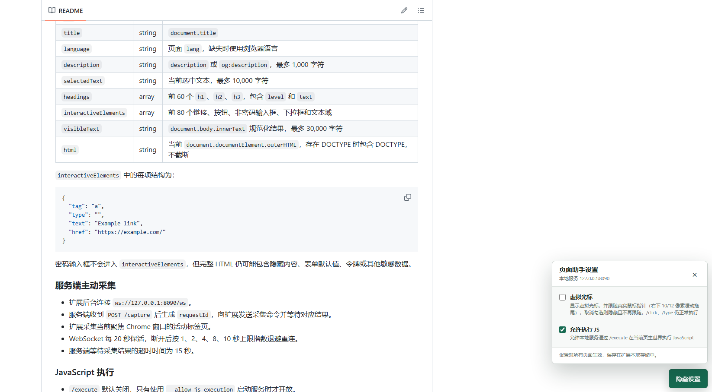

# Page Context Chat

一个 Manifest V3 Chrome 扩展 + 仅监听 `127.0.0.1:8090` 的本地 Python 服务：让本地程序或 AI 编码代理读取当前页面、在页面主世界执行 JavaScript、用虚拟光标点击元素并模拟键盘输入。



> 页面右下角「设置」面板。1.7.0 起页面内不再有聊天输入框，只有这两个开关。

## 功能

**页面侧能力（由本地程序/代理通过 HTTP + WebSocket 驱动）**

| 能力 | 入口 | 说明 |
|---|---|---|
| 采集页面上下文 | `POST /capture` | 标题、URL、可见文本、标题结构、可交互元素、完整 HTML |
| 执行 JavaScript | `POST /execute` | 通过 CDP `Runtime.evaluate` 在页面主世界执行，支持 Promise |
| 虚拟光标点击 | `POST /click` | 滚动到元素中央 → 光标平滑移动 → 派发真实鼠标事件（`isTrusted`） |
| 模拟键盘输入 | `POST /type` | 逐字符派发真实按键，受控组件（React/Vue）也能触发 `onChange` |

`/execute`、`/click`、`/type` 默认关闭，需要服务端启动参数显式开启。

**扩展侧**

- **设置面板**：右下角「设置」按钮或工具栏图标打开，两个勾选项，设置全局生效、跨页面实时同步。
- **虚拟光标**：箭头 + 点击反馈圆环，默认显示并跟随真实鼠标（右下 10/12 像素缓动拖尾）；可整体关闭。
- **自动重新注入**：扩展重载/更新后，已打开页面无需刷新即可恢复通信。
- **兼容软导航**：DOM 被 Turbo/SPA 替换后，面板与光标自动重新挂载。

**设置面板的两个勾选项**

| 勾选项 | 存储键 | 默认 | 作用 |
|---|---|---|---|
| 虚拟光标 | `cursorEnabled` | 开启 | 显示光标并跟随真实鼠标；取消后隐藏并停止跟随（`/click`、`/type` 仍照常执行） |
| 允许执行 JS | `allowJsExecution` | 开启 | 关闭后扩展直接拦截 `/execute`，返回 `js_execution_disabled` |

**服务端**

- 固定绑定回环地址，用 `requestId` 关联并发命令与 WebSocket 回包。
- `POST /chat` 为占位实现，扩展已不再调用，仅供外部程序使用。
- 同一个 exe 带 `--mcp` 即成为 MCP stdio 前端：按需拉起本地服务，再通过 HTTP 调用它，供 OpenCode 等编码代理使用。

## 环境要求

- Chrome 116 或更高版本。
- Python 3.11 或更高版本。
- `aiohttp>=3.10,<4`。
- 仅向普通 `http://` / `https://` 页面注入；Chrome 内部页面、Web Store 和受保护页面不支持。

## 安装与启动

### 1. 安装服务端依赖

```powershell
python -m pip install -r .\server\requirements.txt
```

若提示 `No module named pip`：

```powershell
python -m ensurepip --upgrade
python -m pip install -r .\server\requirements.txt
```

### 2. 启动服务

```powershell
# 普通模式：采集 + 健康检查 + WebSocket + /chat
python .\server\server.py

# 页面交互模式：额外开放 /click、/type
python .\server\server.py --allow-interaction

# JavaScript 执行模式：额外开放 /execute
python .\server\server.py --allow-js-execution

# 全开
python .\server\server.py --allow-js-execution --allow-interaction
```

服务地址固定为 `http://127.0.0.1:8090`。已打包的 `release\page-context-chat-server.exe` 参数完全一致。

### 3. 加载扩展

1. 打开 `chrome://extensions/`，启用「开发者模式」；
2. 点「加载已解压的扩展程序」，选择仓库里的 `extension/` 目录；
3. 接受扩展申请的权限（`debugger`、`tabs`、`scripting`、`storage`）。

使用分发版时，解压 `release/page-context-chat-extension.zip` 后选择解压出的目录（Chrome 已不允许直接安装商店外的 `.crx`）。

### 4. 使用设置面板

打开任意普通网页，点右下角「设置」（或点 Chrome 工具栏里的扩展图标）：

- 面板显示本地服务地址 `127.0.0.1:8090`；
- 勾选状态保存在 `chrome.storage.local`，对所有页面生效，改动会同步到已打开的页面；
- 代码或 Manifest 更新后，在 `chrome://extensions/` 点「重新加载」即可，无需手动刷新页面。

## 接口一览

| 方法 | 路径 | 用途 | 默认可用 |
|---|---|---|---|
| `GET` | `/health` | 服务健康检查 | 是 |
| `POST` | `/chat` | 占位聊天接口，仅供外部程序调用 | 是 |
| `POST` | `/capture` | 采集当前活动页 | 是 |
| `POST` | `/execute` | 在当前活动页执行 JavaScript | 需启动参数 |
| `POST` | `/click` | 虚拟光标移动并点击元素 | 需启动参数 |
| `POST` | `/type` | 向目标元素模拟键盘输入 | 需启动参数 |
| `GET` | `/ws` | 扩展与服务端之间的 WebSocket 通道 | 是 |

请求/响应字段、错误码与示例见 [docs/api.md](docs/api.md)。

## MCP 接入（OpenCode 等）

仓库根目录自带 `opencode.json`，克隆后即可使用：

```json
{
  "mcp": {
    "servers": {
      "page-context-chat": {
        "type": "local",
        "command": ["E:\\python\\Page-Context-Chat\\release\\page-context-chat-server.exe", "--mcp"],
        "timeout": { "startup": 60000 },
        "enabled": true
      }
    }
  }
}
```

`--mcp` 必须带，否则 exe 会以普通 HTTP 服务启动。工具共 5 个：`status`、`capture_page`、`click_element`、`type_text`、`execute_script`。

完整配置（三种接法、权限档位、常见错误）见 [docs/mcp.md](docs/mcp.md)。

## 项目结构

```text
Page-Context-Chat/
|-- extension/            # Chrome 扩展（manifest / background / content）
|-- server/               # 本地服务、MCP stdio 前端与测试脚本
|-- release/              # 分发产物（exe + 扩展 zip）
|-- docs/                 # 文档与截图
|-- opencode.json         # MCP 接入配置
|-- build_release.ps1     # 一键打包
`-- README.md
```

## 文档

| 文档 | 内容 |
|---|---|
| [docs/api.md](docs/api.md) | HTTP 接口：请求/响应、字段说明、错误码 |
| [docs/design.md](docs/design.md) | 系统架构、WebSocket 协议、各能力的实现方式、权限与安全边界 |
| [docs/mcp.md](docs/mcp.md) | MCP 接入：三种配置方式、权限档位、工具清单、配置错误 |
| [docs/development.md](docs/development.md) | 详细项目结构、测试脚本、PyInstaller 打包与分发、停止服务 |
| [docs/troubleshooting.md](docs/troubleshooting.md) | 常见问题（按状态码索引）与已知限制 |
| [docs/changelog.md](docs/changelog.md) | 变更记录 |

## 已知限制

- 没有“只移动光标、不点击”的独立接口：光标只由 `/click`、`/type` 或跟随真实鼠标驱动。
- 面板与光标在 `closed` Shadow DOM 中，页面脚本（含 `/execute`）读不到其内部，只能用 `#page-context-chat-cursor` 的 `data-x`/`data-y` 核对位置。
- 跟随只在顶层文档生效，指针移到跨源 iframe 上时不会继续跟随。
- `/type` 不支持组合键、粘贴与输入法候选词选字；`/click` 不支持双击、右键或拖拽。

完整清单见 [docs/troubleshooting.md#当前限制](docs/troubleshooting.md#当前限制)。
