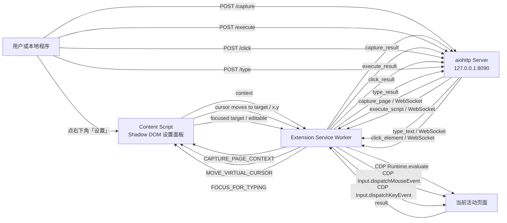

# 设计说明

扩展、服务端、MCP 前端三者的职责边界，页面侧能力的实现方式，以及权限与安全边界。

- 返回 [README](../README.md)
- 相关：[HTTP API](api.md) · [MCP 接入](mcp.md) · [开发与构建](development.md)

## 系统架构

服务端使用 `requestId` 关联并发命令和异步 WebSocket 回包。存在多个扩展连接时，当前实现选择最后建立且仍然存活的连接。

## 能力实现

### 服务端主动采集

- 扩展后台连接 `ws://127.0.0.1:8090/ws`。
- 服务端收到 `POST /capture` 后生成 `requestId`，向扩展发送采集命令并等待对应结果。
- 扩展采集当前聚焦 Chrome 窗口的活动标签页。
- WebSocket 每 20 秒保活，断开后按 1、2、4、8、10 秒上限指数退避重连。
- 服务端等待采集结果的超时时间为 15 秒。

### JavaScript 执行

- `/execute` 默认关闭，只有使用 `--allow-js-execution` 启动服务时才开放。
- 服务端开放后还有第二道闸：扩展设置里的「允许执行 JS」（默认开启）。取消勾选后，扩展会直接回 `js_execution_disabled`（HTTP 422），代码不会进入页面。
- 仅允许当前活动的 HTTP/HTTPS 标签页。
- 扩展通过 Chrome DevTools Protocol `Runtime.evaluate` 在页面主世界执行代码。
- 支持等待 Promise，执行结果尽量按值序列化后返回。
- 单段代码最大 256 KB，浏览器执行超时约 10 秒，HTTP 接口等待上限为 15 秒。
- 执行结束后扩展会主动解除调试器附加。

该能力可以读取登录态、修改页面、调用页面脚本并发起页面权限内的请求，只适合受控本地开发环境，不适合发布到 Chrome Web Store。

### 虚拟光标点击

- 内容脚本会在每个注入页面中注入一个虚拟光标（箭头 + 点击反馈圆环），默认显示，光标不拦截页面交互（`pointer-events: none`）。
- 「虚拟光标」勾选项（默认开启）同时管显示与跟随：取消勾选后光标宿主被 `display: none` 且不再跟随真实指针，但位置仍在维护，`/click`、`/type` 照常执行，`data-x` / `data-y` 也照常更新。
- `/click` 默认关闭，只有使用 `--allow-interaction` 启动服务时才开放。
- 调用方传入 CSS 选择器，或 `text=` / `text*=` 文本选择器，服务端通过 WebSocket 下发 `click_element`。
- 扩展先让目标元素滚动到可视区域中央，再让虚拟光标平滑移动到元素中心，最后通过 CDP `Input.dispatchMouseEvent` 在坐标点派发 `mouseMoved`、`mousePressed`、`mouseReleased`，产生 `isTrusted` 的真实鼠标点击。
- 点击成功用绿色圆环反馈，失败用红色圆环反馈。
- 注入的设置面板和虚拟光标会在 DOM 被替换后自动重新挂载，兼容 GitHub 等采用 Turbo/SPA 软导航的页面。
- 仅允许当前活动的 HTTP/HTTPS 标签页；单次点击等待上限为 15 秒。

### 模拟输入

- `/type` 属于页面交互能力，和 `/click` 一样默认关闭，使用 `--allow-interaction` 启动时开放。
- 传 `selector`（CSS 或 `text=` / `text*=`）时，扩展先把目标滚动到可视区域中央、让虚拟光标移过去并聚焦该元素；省略 `selector` 时直接输入到当前焦点元素。
- 逐字符通过 CDP `Input.dispatchKeyEvent` 派发 `keyDown` / `keyUp`，英文字母、数字、空格、回车、Tab 都带正确的 `code` 和虚拟键码；没有按键定义的字符（中文、表情、生僻符号）改用 `Input.insertText` 插入。
- 走的是真实按键事件而不是脚本改写 `value`，所以受控组件（React/Vue）的 `onChange`、`input` 事件和依赖 `keydown` 的快捷键逻辑都能被正常触发。
- 可选 `clear` 在输入前清空目标元素（用原生 value setter + `input` 事件，兼容受控组件），可选 `submit` 在输入完成后按一次回车。
- 可选 `delayMs` 控制逐字延迟（默认 30 毫秒，模拟真实打字节奏）；`text` 与 `delayMs` 组合的预计耗时上限为 60 秒。

### 虚拟光标跟随真实鼠标

- 设置面板里的「虚拟光标」勾选项控制显示与跟随（1.7.0 起合并为一个开关，默认开启）；开关状态用 `chrome.storage.local` 保存，所有页面共用（1.6.0 起支持跟随，1.7.0 起改由设置面板统一控制，并在改动时通过 `chrome.storage.onChanged` 同步到已打开的页面）。
- 开启后虚拟光标以**右下 10/12 像素偏移**、每帧 0.3 缓动（平滑拖尾）跟随真实指针；打开开关的瞬间就会从当前位置滑向指针，不需要先晃一下鼠标。
- `/click`、`/type` 期间跟随显式暂停：动作开始（`scrollAndPointTo()`）即按住，直到后台回传 `CLICK_FEEDBACK` / `TYPE_FEEDBACK` 才解除，并额外保留 400 毫秒宽限，另有 120 秒兜底防止回包丢失后永久按住。因此动作结束后光标**停在目标上**，直到你再次移动鼠标才滑回指针旁边。
- 是否「用户真的在移动鼠标」以 **`screenX` / `screenY`** 判断，而不是 `clientX` / `clientY`。滚动、搜索联想下拉，以及视口变化都会让 Chrome 为**静止的**指针重算 `clientX/clientY` 并补发 `mousemove`，这类事件不会把光标带走（详见[常见问题](troubleshooting.md#光标跟随开启后动作结束时会自己滑回指针旁边)）。
- `resize` 事件只做视口边界收敛，不会重设跟随目标。
- 虚拟光标当前位置同步在 `#page-context-chat-cursor` 的 `data-x` / `data-y` 属性上（CSS 像素、视口坐标），便于用 `POST /execute` 核对光标是否真的走到了目标。
- 已知限制：仅在顶层文档生效，指针移到跨源 iframe 上时浏览器不会把 `mousemove` 传给外层文档（见[已知限制](troubleshooting.md#当前限制)）。

## 权限说明

| 权限                    | 用途                                                                                                                                              |
| ----------------------- | ------------------------------------------------------------------------------------------------------------------------------------------------- |
| `tabs`                | 定位当前聚焦窗口的活动标签页，并判断是否为 HTTP/HTTPS 页面                                                                                        |
| `debugger`            | 附加活动标签页并调用 CDP `Runtime.evaluate` 执行代码，或用 `Input.dispatchMouseEvent` 派发真实点击、用 `Input.dispatchKeyEvent` 模拟键盘输入 |
| `scripting`           | 在扩展重载后向已打开的页面重新注入内容脚本，省去手动刷新                                                                                          |
| `storage`             | 保存设置面板的两个勾选项（虚拟光标 / 允许执行 JS），让设置在页面之间保持一致                                                                      |
| `host_permissions`    | 允许扩展后台访问 `127.0.0.1:8090` 和 `localhost:8090`，并对 HTTP/HTTPS 页面拥有注入权限（供 `scripting` 使用）                               |
| HTTP/HTTPS 内容脚本匹配 | 注入设置面板、采集当前页面 DOM 和上下文                                                                                                           |

`debugger` 是高权限能力，Chrome 会在执行时显示调试器附加提示。如果 Chrome DevTools 或其他调试器已经附加到同一标签页，JavaScript 执行可能失败。

## 安全与隐私

- 服务端固定监听 `127.0.0.1`，不向局域网暴露。
- 带 `Origin` 的请求只接受 `chrome-extension://` 来源；普通网页来源返回 `403 origin_forbidden`。
- 无 `Origin` 的本地命令行和本地程序可以访问接口，因此回环地址限制不是进程级身份认证。
- `/execute` 默认关闭，必须显式使用启动参数；扩展侧的「允许执行 JS」勾选项（默认开启）会再拦一层，取消勾选后即使服务端开放也会返回 `js_execution_disabled`。
- `/click` 默认关闭，必须显式使用 `--allow-interaction`；它会以真实鼠标事件点击任意由选择器命中的元素，可能触发提交、删除或支付等不可逆操作。
- `/type` 同样默认关闭，必须显式使用 `--allow-interaction`；它会向任意由选择器命中的元素输入文本，配合 `submit` 可以触发搜索、提交等操作。
- `--mcp` 默认以**全权限**拉起本地服务（`--allow-js-execution --allow-interaction`）：这意味着任何能访问 `127.0.0.1:8090` 的本地进程都能无鉴权调用 `/execute`。需要收窄就用 `--mcp-service-mode`，或在 MCP 客户端侧按 `page_context_chat_execute_script` 之类的工具名 deny。
- 页面 HTML 不截断，发送前应确认页面是否含敏感信息。
- HTTP 请求体和 WebSocket 单条消息上限均为 50 MB。
- 页面上下文不持久化到数据库，采集结果只在请求-响应链路中传递；设置面板的开关存在 `chrome.storage.local`。
- 项目当前未实现访问令牌、调用方鉴权、审计日志或代码执行白名单。

